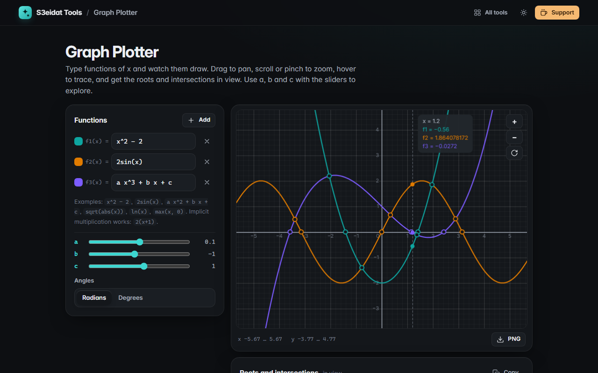

# Graph Plotter

> Plot functions, explore them with sliders, and find roots and intersections. Free, private, and it runs entirely in your browser.

### ▶ [Open Graph Plotter](https://s3eidat.github.io/graph-plotter/)



## Features

- Up to **six functions** `y = f(x)`, each in its own colour, with show/hide
- **Own expression parser** (no `eval`): `+ − × ÷ ^`, brackets, implicit multiplication (`2x`, `2(x+1)`, `a x^2`), correct precedence (`2^3^2 = 512`, `−2^2 = −4`)
- Functions: `sin cos tan sec csc cot`, `asin acos atan atan2`, `sinh cosh tanh asinh acosh atanh`, `sqrt cbrt root abs ln log log2 log10 exp floor ceil round sign min max mod`, constants `pi e tau phi`
- **Sliders** for parameters `a`, `b` and `c` (−10 to 10)
- **Pan** by dragging, **zoom** with the wheel, pinch or the buttons (double-click zooms in), radians or degrees
- **Trace**: hover to read every function's value at x
- **Roots and intersections** of the functions in view, found numerically (bisection, poles such as `tan x` are rejected) and marked on the graph
- **Export PNG**; functions, sliders and view are remembered on this device

Unknown names (like `alert` or `window`) are rejected: an expression can only use the functions above and the variables `x, a, b, c`.

## Privacy

Nothing leaves your device. There is no server, no account, no analytics.
The page ships with a strict Content-Security-Policy (`connect-src 'self'`), so the browser
itself blocks any attempt to send data anywhere.

## Run it yourself

It's plain HTML, CSS and JavaScript with no build step:

```bash
git clone https://github.com/s3eidat/graph-plotter
cd graph-plotter
python -m http.server 8000
```

Then open http://localhost:8000.

## Support

If this saved you time, **[buy me a coffee ☕](https://s3eidat.github.io/coffee/)**. It keeps every tool free.

---

Part of **[S3eidat Tools](https://s3eidat.github.io/)**: 100+ free, private tools that run in your browser. MIT licensed.
